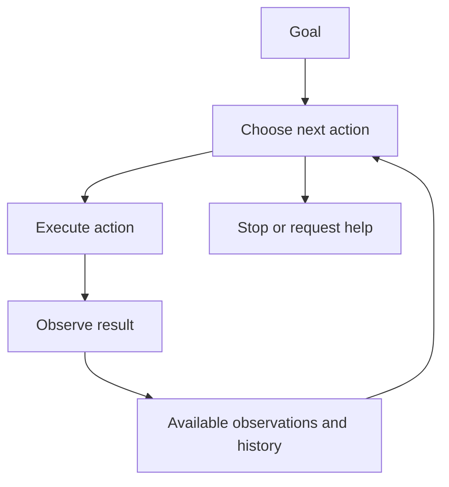

# Agentic AI foundations: agents, reasoning, planning, and reflection

Study notes distilled from a guided learning session. This is a conceptual summary, not a verbatim transcript.

## 1. What is an AI agent?

An agent perceives its environment and acts upon it. This broad definition, associated with Russell and Norvig, includes rule-based systems as well as LLM-backed agents.

| Component | Role | In a performance-diagnosis agent |
| --- | --- | --- |
| Environment | The world the agent observes and interacts with | Services, monitoring systems, logs, configuration, and the user |
| Sensors | Interfaces that obtain observations | Metrics APIs, log readers, configuration inspection |
| Actuators | Interfaces that perform actions | Tools that run experiments, change configuration, or scale replicas |
| Agent program | Logic that maps available observations and goals to actions | The model plus orchestration and execution-control software |

A sensor need not process images or audio. Reading metrics through a text-returning API is also perception. One tool can support observation or action depending on the operation invoked.

In an operational LLM agent, the model proposes decisions while surrounding software constructs context, executes tools, manages state, enforces permissions, and controls termination.

Memory, tools, planning, and reflection support sophisticated behavior. A specialized reasoning model and separate planning or memory modules are not universal requirements under the broad agent definition.

## 2. The observation–action feedback loop

The central systems idea is a loop in which new observations influence subsequent decisions.

A useful abstraction is:

$$
a_t = \pi(h_t, g)
$$

Here, the policy π selects action a_t using the available interaction history h_t and goal g. Observations can be incomplete, delayed, or misleading.

**Learning checkpoint:** To make a fixed sequence of tool calls adaptive, introduce a decision step that examines tool results and selects the next action based on the goal.

For example, diagnosing elevated p99 latency:

| Observation | Possible next action |
| --- | --- |
| Queueing time increased | Inspect arrival rate and serving capacity |
| Queueing is low but execution is slow | Inspect execution traces and resource behavior |
| Evidence supports a diagnosis | Validate it or report the finding |
| Required evidence is inaccessible | Use an authorized alternative or request help |

Stopping is itself a decision. The selected action is an estimate of what will help, not a guarantee.

## 3. Why generate intermediate reasoning tokens?

Intermediate reasoning gives a model additional computational steps and a working context before it produces its final answer.

| Benefit | Purpose |
| --- | --- |
| Decomposition | Break a difficult problem into manageable subproblems |
| Intermediate results | Carry calculations and conclusions into later steps |
| Checking and revision | Find contradictions or reconsider assumptions |
| Alternative evaluation | Compare explanations or candidate actions |
| Tool planning | Identify missing evidence and select useful tool calls |

In ordinary autoregressive generation, intermediate tokens become context for subsequent tokens. The model's weights ordinarily stay fixed during inference.

For a capacity calculation, the model might derive per-request resource demand, identify the limiting resource, and then calculate sustainable throughput. Each intermediate result supports the next operation.

The paper-and-pencil analogy is useful: a working record helps with dependent steps. It does not establish that models think like humans or that generated reasoning is a faithful account of every internal computation.

**More tokens do not guarantee better reasoning.** A long response can elaborate a mistaken assumption. Reasoning also cannot replace a measurement that has never been obtained.

## 4. Training compute versus inference compute

| Budget | When spent | Main purpose |
| --- | --- | --- |
| Training compute | During model development | Learn capabilities by updating parameters |
| Inference compute | During a particular request | Apply learned capabilities to the current task |

These budgets complement each other. Training can teach the model to use extra inference computation effectively.

Reasoning models generally have an advantage on tasks that benefit from dependent steps, checking, alternatives, and planning. Examples include mathematical derivations, complex coding, and diagnosis with competing hypotheses.

The advantage depends on the task and model. Simple questions may gain little; missing evidence remains missing even after additional reasoning.

The transition from pretraining scaling to reasoning is not a proven hard ceiling on pretraining. Earlier models could also generate intermediate steps; reasoning-focused training seeks to make this behavior more effective.

## 5. Are reasoning models trained differently?

The main distinction is often in **post-training objectives, examples, and rewards**, rather than a fundamentally different transformer architecture or generation mechanism.

| Stage | What it teaches |
| --- | --- |
| Pretraining | Language, knowledge, and patterns from large datasets |
| Supervised fine-tuning | Desired behavior through example responses, potentially including worked solutions |
| Reinforcement learning | Behavior that earns higher rewards, potentially including verified solution correctness |

Regular chat models can also use supervised fine-tuning and reinforcement learning. RL alone does not define a reasoning model.

A simplified reasoning-focused RL process:

1. Present a problem.
2. Generate a candidate solution with intermediate steps.
3. Evaluate the outcome, for example using a mathematical verifier or code tests.
4. Use rewards to update the model's weights.
5. Repeat across many problems.

An outcome reward can guide learning without humans prescribing every intermediate step. Rewarding a correct answer does not establish that every step in its generated explanation is correct.

DeepSeek-R1-Zero demonstrated reasoning-focused RL without preliminary supervised fine-tuning of the pretrained base model. DeepSeek-R1 used a broader multistage training pipeline.

**Distillation** provides another route: train a student model on worked solutions generated by a stronger teacher.

Key distinction:

- During training, weights change to learn useful behavior.
- During ordinary inference, context changes as tokens are generated while weights stay fixed.

Prompting a regular model to work step by step can help, but is not equivalent to reasoning-focused training.

## 6. Planning, execution, reflection, and replanning

A plan is a working proposal for reaching a goal.

| Activity | Main question |
| --- | --- |
| Planning | Which actionable steps should achieve the goal? |
| Execution | What happens when the selected step is performed? |
| Reflection | Does the result match expectations, and are we making progress? |
| Replanning | Which remaining steps should change given the evidence? |

**Task decomposition** breaks a large goal into smaller actionable steps. The agent can track completed work and revise remaining work as it learns.

Example: an agent initially plans to investigate traffic and resource saturation. It discovers unchanged traffic and a latency increase immediately after deployment. It revises its plan to inspect deployment changes and compare traces before and after the change. Timing suggests a hypothesis; it does not establish causation.

Dependent tasks need appropriate ordering. Independent evidence gathering, such as reading traffic metrics and deployment history, can run concurrently.

## 7. Productive reflection versus blind retries

Productive reflection compares results against expectations and uses evidence to choose a better next step.

| Result | Evidence-based response |
| --- | --- |
| No matching logs | Check the time window, filters, service, and log source |
| Temporary connection failure | Consider a bounded retry |
| Access denied | Check required permissions, use an authorized alternative, or request help |
| Proposed fix leaves latency unchanged | Reassess the hypothesis and experiment |
| Success criteria are met | Stop and report the result |

A retry is justified when there is a reason to expect it to help. Repeating the same failed action without such a reason is not productive reflection.

Asking the model to “think again” supplies no new evidence by itself. Measurements, tests, tool results, and explicit success criteria make reflection more grounded.

## 8. Performance-engineering implications

Reasoning tokens consume compute even when hidden from the user. For a simplified sequential model:

$$
T_{\text{response}} \approx T_{\text{queue}} + T_{\text{prefill}} +
(N_{\text{reasoning}} + N_{\text{answer}})\,\overline{T}_{\text{decode/token}}
$$

This approximation assumes an average decode time; actual time depends on model, context length, batching, hardware, and serving conditions.

Additional reasoning generally increases per-call computation and final-answer latency under comparable conditions. With conventional KV caching, additional retained tokens also consume KV-cache space. Billed price depends on the provider's pricing policy.

For a sequential agent:

$$
T_{\text{task}} \approx
\sum_i T_{\text{model},i}
+ \sum_j T_{\text{tool},j}
+ T_{\text{orchestration}}
$$

Concurrent work requires critical-path analysis rather than summing all durations.

Extra reasoning can reduce total task time by avoiding unnecessary actions. If three additional seconds of reasoning avoid two sequential five-second tool calls, the task becomes seven seconds faster.

Evaluate agents using:

- Task success and evidence quality.
- End-to-end latency, including tail latency.
- Compute or monetary cost per successful task.
- Tool-call count, retries, and wasted work.
- Number of decision cycles and effectiveness of stopping.

The engineering objective is to allocate reasoning, tools, and parallelism where they improve successful task completion.

## References discussed

- Russell and Norvig, *Artificial Intelligence: A Modern Approach*: broad agent definition.
- DeepSeek-AI, [DeepSeek-R1: Incentivizing Reasoning Capability in LLMs via Reinforcement Learning](https://arxiv.org/abs/2501.12948).
- [DeepSeek-R1 official repository](https://github.com/deepseek-ai/DeepSeek-R1): model and distillation information.